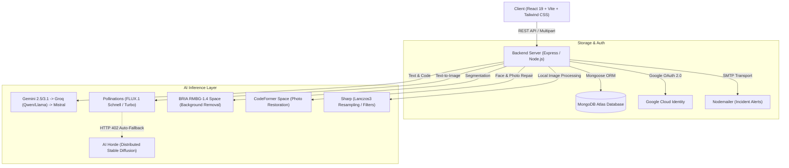
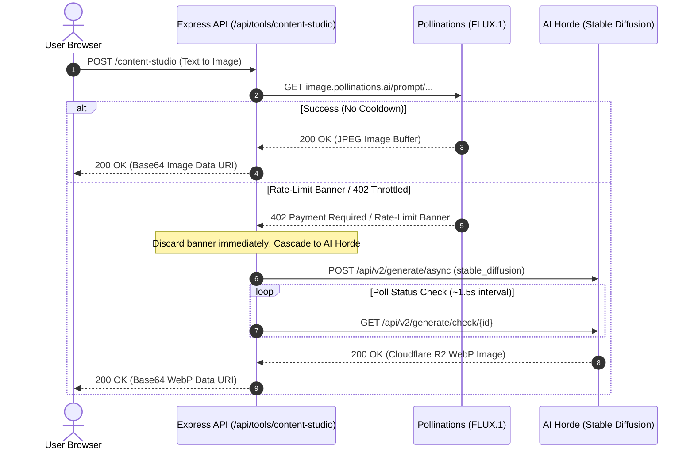

# 🌌 NexusAI — All-in-One AI SaaS Platform

[](https://react.dev/)
[](https://vitejs.dev/)
[](https://nodejs.org/)
[](https://expressjs.com/)
[](https://www.mongodb.com/atlas)
[](https://tailwindcss.com/)
[](LICENSE)

> **NexusAI** is a comprehensive, production-ready AI SaaS ecosystem designed to consolidate creative studio workflows, developer productivity accelerators, career optimization tools, and developer incident reporting into a single, unified interface.

---

## 📑 Table of Contents

- [Overview](#-overview)
- [Key Features](#-key-features)
  - [Flagship Productivity Tools](#1-flagship-productivity-tools)
  - [Creative Content Studio (13 Engines)](#2-creative-content-studio-13-engines)
  - [Developer Incident Reporting System](#3-developer-incident-reporting-system)
  - [Authentication & Generation History](#4-authentication--generation-history)
- [Architecture & Data Flow](#-architecture--data-flow)
- [Technology Stack](#-technology-stack)
- [Getting Started](#-getting-started)
  - [Prerequisites](#prerequisites)
  - [Installation](#installation)
  - [Environment Variables](#environment-variables)
  - [Running Locally](#running-locally)
- [API Reference](#-api-reference)
- [Production Deployment](#-production-deployment)
- [Project Directory Structure](#-project-directory-structure)

---

## 🌟 Overview

NexusAI eliminates subscription fatigue and context switching by unifying state-of-the-art AI models into one coherent dark-monochromatic application:
- **Resilient AI Pipelines**: Multi-tiered fallback cascade across Google Gemini 2.5/3.1, Groq (Qwen/Llama), Mistral AI, Pollinations, and decentralized AI Horde.
- **Zero-Key Neural Services**: Integrated SOTA computer vision models including **BRIA RMBG-1.4** for background segmentation and **CodeFormer** for facial and vintage photo restoration.
- **Enterprise-Grade UI**: Monochromatic typography, fluid layout grids, real-time Markdown/table renderers, and instant clipboard paste support.

---

## 🚀 Key Features

### 1. Flagship Productivity Tools

| Tool | Core Capability | Under the Hood |
| :--- | :--- | :--- |
| **Code Reviewer** | Comprehensive code audits, syntax flaw detection, security vulnerability scanning, and refactored drop-in code suggestions. | Gemini 2.5 Flash / Groq LLM with AST and syntax analysis prompts |
| **Resume Optimizer** | Upload PDF/DOCX resumes for ATS scoring, gap analysis, keyword density recommendations, and targeted job role tailoring. | `pdf-parse`, `mammoth` text extraction + semantic evaluation |
| **Smart Summarizer** | Distill lengthy documents, whitepapers, and articles into executive summaries, bullet points, and actionable takeaways. | Multi-format document parser + recursive LLM context condensation |
| **SQL Generator** | Natural language to production-grade SQL with schema understanding across PostgreSQL, MySQL, SQLite, and Snowflake. | Structured SQL synthesis with query optimization rules |

---

### 2. Creative Content Studio (13 Engines)

The **Content Studio** (`/tools/content-studio`) hosts specialized multimodal tools with real-time parameter configuration:

#### 🎨 Visual & Generative Imaging
- **Text to Image**: Multi-model neural generation supporting **FLUX.1 Schnell**, **FLUX Realism**, **SDXL Turbo**, and **Sana 1.6B**.
  - *Resilient Auto-Fallback*: Intercepts rate-limit cooldowns (HTTP 402) and cascades seamlessly to decentralized **AI Horde (Stable Diffusion)**.
  - Aspect ratio flexibility: `1:1 Square`, `16:9 Wide`, `9:16 Portrait`, and `4:3`.
- **Logo & Icon Maker**: Creates scalable corporate logo marks, modern iOS squircle app icons, luxury monograms, and mascot badges with custom style and color palettes.
- **Background Remover**: Integrated **BRIA RMBG-1.4** neural segmentation for clean cutouts.
  - Supports **Transparent**, **Studio White**, **Matte Black**, or **Blurred Bokeh** composite backdrops.
- **AI Upscaler**: **Lanczos-3 sinc resampling** with unsharp masking ($m_1=1.5, m_2=0.8$) and median de-noising for crisp 2x, 4x, and 8x enlargements up to 8K resolution.
- **Photo Restore**: Integrated **CodeFormer (Shangchen Zhou / S-Lab)** for vintage portrait repair, scratch elimination, facial alignment, and tonal color balancing.

#### ✍️ Copywriting & Language
- **Social & Ad Copy**: Generates viral hooks, structured formatted tables (with border grids, alternating row highlights, and clean text toggle), and persuasive CTAs.
- **Email Composer**: Formulates cold outreach, newsletter editions, welcome sequences, and follow-ups with reading time and word count indicators.
- **Script Writer**: Full-length video and audio scripts for YouTube, Reels/Shorts, Podcasts, and Ads with Scene/Beat directions (`[Visual:]`, `[Camera:]`, `[Text on screen:]`).
- **Rewriter & Paraphraser**: Rephrase, expand, shorten, or simplify content with a live creativity slider (0–100%) and tone adaptation.
- **Translator**: Inbuilt search bar inside a custom dropdown supporting **105+ world languages** with auto-detection and formality selection.

#### 🎙️ Voice & Audio
- **Voiceover (TTS)**: Natural text-to-speech voice generation with automated chunking.
- **Music Generator**: Synthesizes custom ambient, lo-fi, and background tracks from text briefs.
- **Audio Transcription**: Audio-to-text transcript processing.

---

### 3. Developer Incident Reporting System

Accessible from the navbar avatar menu under the **History** tab (or at `/report`):
- **Full Context Gathering**: Auto-detects operating system, browser, viewport dimensions, user identity, and URL context.
- **Tool-Specific Bug Scoping**: Select the exact tool, severity level (*Low, Medium, High, Critical / Blocker*), and issue category.
- **Screenshot Upload & Direct Paste**: Supports drag-and-drop, standard file picker, and **direct clipboard pasting (`Ctrl+V`)**.
- **Dual Notification**:
  1. Stores persistent incident tickets (e.g. `NEX-829104`) in MongoDB Atlas.
  2. Dispatches an email with embedded screenshot attachments to the lead developer (`avpodder000@gmail.com`).
  3. Sends a confirmation tracking receipt to the reporter.

---

### 4. Authentication & Generation History

- **JWT & Google OAuth 2.0**: Secure authentication, user avatars, password validation, and OTP verification via Nodemailer.
- **Centralized History**: Automatic saving of text outputs, generated code, and images with one-click copy, download, and delete.

---

## 📐 Architecture & Data Flow

### System Overview



### Multi-Model Image Fallback Flow



---

## 🛠️ Technology Stack

### Frontend
- **Framework**: [React 19](https://react.dev/) + [Vite 8](https://vitejs.dev/)
- **Routing**: [React Router DOM v7](https://reactrouter.com/)
- **Styling**: [Tailwind CSS v4](https://tailwindcss.com/)
- **Icons**: [Lucide React](https://lucide.dev/)
- **Notifications**: [React Hot Toast](https://react-hot-toast.com/)
- **Authentication**: [@react-oauth/google](https://www.npmjs.com/package/@react-oauth/google)

### Backend
- **Runtime**: [Node.js 22 (ES Modules)](https://nodejs.org/)
- **Framework**: [Express 4.21](https://expressjs.com/)
- **Database**: [MongoDB Atlas](https://www.mongodb.com/atlas) with [Mongoose 8](https://mongoosejs.com/)
- **Image Processing**: [Sharp 0.34](https://sharp.pixelplumbing.com/) (Lanczos3, unsharp masking, channel composition)
- **File Handling**: [Multer](https://github.com/expressjs/multer), [pdf-parse](https://www.npmjs.com/package/pdf-parse), [mammoth](https://www.npmjs.com/package/mammoth)
- **Email Dispatch**: [Nodemailer 8](https://nodemailer.com/)

### AI & Neural Models
- **Text & Code**: Google Gemini 2.5 Flash, Groq (`qwen-2.5-32b` / `llama-3.3-70b`), Mistral AI
- **Image Generation**: FLUX.1 Schnell, FLUX Realism, SDXL Turbo, Sana 1.6B, Stable Diffusion (AI Horde)
- **Computer Vision**: BRIA RMBG-1.4 (Background Removal), CodeFormer (S-Lab Photo Reconstruction)
- **Speech**: Google TTS API

---

## 🚀 Getting Started

### Prerequisites
- **Node.js**: v18.0.0 or higher (v20+ or v22+ recommended)
- **npm** or **yarn**
- **MongoDB**: A free MongoDB Atlas cluster connection URI or local MongoDB instance

---

### Installation

1. **Clone the repository:**
   ```bash
   git clone https://github.com/avro000/ai-SaaS-application.git
   cd ai-SaaS-application
   ```

2. **Install Frontend Dependencies:**
   ```bash
   npm install
   ```

3. **Install Backend Dependencies:**
   ```bash
   cd server
   npm install
   cd ..
   ```

---

### Environment Variables

#### Root Frontend `.env`
Create `.env` in the root folder:
```env
# Google OAuth Client ID for Google One-Tap & Sign-in
VITE_GOOGLE_CLIENT_ID=your_google_oauth_client_id.apps.googleusercontent.com
```

#### Server Backend `server/.env`
Create `server/.env`:
```env
PORT=5000
CLIENT_URL=http://localhost:5173

# MongoDB Connection String
MONGO_URI=mongodb+srv://<username>:<password>@cluster0.mongodb.net/nexusai?retryWrites=true&w=majority

# JWT Authentication Secret
JWT_SECRET=your_super_secret_jwt_key_here

# Google OAuth Client ID (must match frontend)
GOOGLE_CLIENT_ID=your_google_oauth_client_id.apps.googleusercontent.com

# AI Inference Keys (Primary & Fallback)
GEMINI_API_KEY=your_gemini_api_key_here
GROQ_API_KEY=your_groq_api_key_here
MISTRAL_API_KEY=your_mistral_api_key_here
HUGGINGFACE_API_KEY=your_huggingface_api_key_here

# Optional: Pollinations App Key
POLLINATIONS_API_KEY=

# SMTP Email Configuration (Incident Reports & Password Recovery)
SMTP_HOST=smtp.gmail.com
SMTP_PORT=587
SMTP_SECURE=false
SMTP_USER=your_email@gmail.com
SMTP_PASS=your_16_character_google_app_password
ADMIN_EMAIL=your_email@gmail.com
```

> **Note on Gmail SMTP**: For live email delivery, generate a 16-character [Google App Password](https://myaccount.google.com/apppasswords) and set it as `SMTP_PASS`.

---

### Running Locally

You can run the client and server concurrently in two terminal sessions:

**Terminal 1 — Backend API Server:**
```bash
cd server
npm run dev
# Server boots on http://localhost:5000 with MongoDB auto-connect
```

**Terminal 2 — Frontend Client:**
```bash
npm run dev
# Client dev server launches at http://localhost:5173
```

---

## 📡 API Reference

### Core Endpoints

| Method | Endpoint | Description | Auth Required |
| :--- | :--- | :--- | :---: |
| `GET` | `/api/health` | Healthcheck and server timestamp | No |
| `POST` | `/api/auth/register` | Register new user with password / OTP | No |
| `POST` | `/api/auth/login` | Email/password login; returns JWT | No |
| `POST` | `/api/auth/google` | Google OAuth token verification & session creation | No |
| `POST` | `/api/tools/content-studio` | Unified Content Studio processor (All 13 visual/text/audio engines) | Yes |
| `POST` | `/api/tools/code-review` | Code audit, security check, and refactoring recommendations | Yes |
| `POST` | `/api/tools/resume-optimizer` | Parse resume document against job description | Yes |
| `POST` | `/api/tools/smart-summarize` | Recursive document summarization | Yes |
| `POST` | `/api/tools/generate-sql` | Natural language to dialect-specific SQL | Yes |
| `GET` | `/api/history` | Retrieve user's generation activity | Yes |
| `POST` | `/api/reports` | Submit bug/tool incident report (with screenshot upload) | Optional |
| `GET` | `/api/reports/my-reports` | Retrieve tickets submitted by current user | Yes |

---

## 🌐 Production Deployment

### Frontend (Vercel / Netlify)
1. Set the root build command to: `npm run build`
2. Output directory: `dist`
3. Environment variables: Add `VITE_GOOGLE_CLIENT_ID`

### Backend (Render / Railway / DigitalOcean)
1. Root directory: `server`
2. Build command: `npm install`
3. Start command: `node server.js`
4. Set environment variables from `server/.env.example` (make sure `CLIENT_URL` matches your frontend production domain).

---

## 📁 Project Directory Structure

```text
NexusAI/
├── .env.example                  # Frontend environment template
├── .gitignore                    # Git exclusions
├── index.html                    # Single-page HTML entrypoint
├── package.json                  # Frontend dependencies & scripts
├── vite.config.js                # Vite build configuration
├── README.md                     # Project documentation
├── src/
│   ├── App.jsx                   # React Router route registry
│   ├── main.jsx                  # React DOM mount point
│   ├── components/
│   │   ├── Landing/              # Navigation, Hero, Features, Pricing, Footer
│   │   ├── Tools/                # Tool-specific UI modules
│   │   └── ui/                   # Reusable buttons, badges, modals, toast
│   ├── context/
│   │   └── AuthContext.jsx       # Global session & token state
│   ├── hooks/
│   │   └── useAuth.js            # Authentication hook
│   └── pages/
│       ├── LandingPage.jsx       # Marketing home
│       ├── ToolsPage.jsx         # Tools directory & launcher
│       ├── ContentStudioPage.jsx # 13-in-1 Multimodal Content Studio
│       ├── CodeReviewerPage.jsx  # Code reviewer
│       ├── ResumeOptimizerPage.jsx # ATS Resume optimizer
│       ├── SmartSummarizerPage.jsx # Document summarizer
│       ├── SqlGeneratorPage.jsx  # SQL query synthesizer
│       ├── HistoryPage.jsx       # Saved generations & history
│       ├── ReportIssuePage.jsx   # Bug & incident reporter
│       ├── LoginPage.jsx         # Sign in
│       └── RegisterPage.jsx      # Sign up
└── server/
    ├── .env.example              # Backend environment template
    ├── package.json              # Server dependencies & scripts
    ├── server.js                 # Express server & DB connection
    ├── config/
    │   └── db.js                 # Mongoose MongoDB connection
    ├── controllers/
    │   ├── authController.js     # User registration, login, Google OAuth
    │   ├── contentStudioController.js # Unified studio dispatcher
    │   ├── historyController.js  # User generation history CRUD
    │   ├── reportController.js   # Incident ticket storage & email dispatch
    │   └── toolController.js     # Code, Resume, Summary, SQL controllers
    ├── middleware/
    │   ├── authMiddleware.js     # JWT bearer protection
    │   └── errorHandler.js       # Centralized error handler
    ├── models/
    │   ├── History.js            # Generation history schema
    │   ├── Report.js             # Incident report schema
    │   └── User.js               # User accounts schema
    ├── routes/
    │   ├── authRoutes.js         # /api/auth
    │   ├── historyRoutes.js      # /api/history
    │   ├── reportRoutes.js       # /api/reports
    │   └── toolRoutes.js         # /api/tools
    └── services/
        ├── geminiService.js      # Google Gemini 2.5/3.1 integration
        ├── groqService.js        # Groq Llama/Qwen integration
        ├── mistralService.js     # Mistral AI integration
        └── huggingfaceService.js # Image gen, CodeFormer, RMBG-1.4, Lanczos upscaler
```

---

## 📄 License

This project is licensed under the [MIT License](LICENSE).

---

Developed with ❤️ by **Avro Podder** • [GitHub (@avro000)](https://github.com/avro000)
